<div align="center">
  <h1>Notion Grass Heatmap</h1>
  <p>노션 데이터베이스를 GitHub 잔디처럼 보여 주는 위젯</p>

  <a href="https://github.com/seonghyeonn/notion-grass-heatmap-habit-tracker/actions/workflows/ci.yml"></a>
  <a href="LICENSE"></a>
  <a href="README.md"></a>
</div>

<br />

<picture>
  <source media="(prefers-color-scheme: dark)" srcset="examples/notion-dark-ko.svg" />
  <source media="(prefers-color-scheme: light)" srcset="examples/notion-light-ko.svg" />
  
</picture>

노션에 메모, 독서 기록, 습관 체크를 하고 있는데 실제로 며칠이나 꾸준히 했는지 한눈에 보고 싶었습니다. </br>써 본 습관 위젯들은 위젯 안에서 따로 체크해야 해서 기록을 두 번 하게 되더군요. 이 위젯은 이미 쓰고 있는 데이터베이스를 그대로 읽습니다.

페이지가 만들어진 날이나 원하는 날짜 속성을 기준으로 하루를 셉니다. 기록이 있었는지만 볼 수도 있고, 페이지 개수나 숫자 속성의 합, 체크된 체크박스 수로 진하기를 나눌 수도 있습니다.

공용 서버는 없습니다. 각자 Vercel(개인 용도는 무료)에 배포해서 쓰기 때문에 노션 토큰이 내 계정 밖으로 나가지 않습니다.

## 빠른 설정

1. 노션 연결(Connection)을 만듭니다.
   - [notion.so/profile/integrations](https://www.notion.so/profile/integrations)를 열면 **Developer tools > Connections** 화면이 나옵니다. **New connection**을 누릅니다.
   - Authentication method는 **API token**을 고릅니다. OAuth는 필요 없습니다.
   - Capabilities에서 **Read content**만 켜고 나머지는 모두 끕니다. User capabilities는 **No user information**을 고릅니다. 이 앱은 읽기만 하므로 토큰이 새더라도 노션 내용을 바꿀 수 없습니다.
   - `ntn_`으로 시작하는 **API token**을 복사합니다.
2. 노션에서 잔디로 볼 데이터베이스를 열고 오른쪽 위 `•••` > **연결(Connections)**에서 방금 만든 연결을 추가합니다. 그다음 같은 메뉴에서 **링크 복사**를 합니다. 이 단계를 빠뜨리면 "데이터베이스를 찾을 수 없다"는 오류 카드가 나옵니다.
3. 아래 버튼으로 배포합니다. Vercel이 환경 변수를 물어보면 이렇게 넣습니다.
   - `NOTION_TOKEN`: 1번에서 복사한 API 토큰
   - `DEFAULT_DATABASE`: 2번에서 복사한 데이터베이스 링크. 이 데이터베이스만 읽을 수 있게 자동으로 잠깁니다.
   - `DEFAULT_TITLE`: 카드 제목 (미리 채운 값: `활동 기록`). 예: `메모 기록`
   - `DEFAULT_THEME`: 색 테마 (미리 채운 값: `auto`, 노션 라이트/다크 자동). [전체 테마](docs/themes.md)
   - `DEFAULT_FORMAT`, `DEFAULT_TIMEZONE`, `DEFAULT_LOCALE`: 미리 채워져 있으니 그대로 둡니다

   [][vercel-deploy]

4. `https://<내-앱>.vercel.app/api/status`에서 `"ok": true`가 나오는지 확인합니다.
5. 노션에서 `/embed`를 입력하고 붙여 넣습니다. 옵션은 주소 뒤에 붙이거나 환경 변수로 바꿀 수 있습니다.

   ```
   https://<내-앱>.vercel.app/api/heatmap
   ```

> [!TIP]
> `db`에는 노션에서 복사한 링크를 통째로 넣어도 됩니다. ID를 따로 찾을 필요가 없습니다.

## 예시

```
# 오늘 메모를 썼는지
/api/heatmap?db=<id>&tz=Asia/Seoul&locale=ko

# 날짜 속성 기준으로 하루에 읽은 쪽수
/api/heatmap?db=<id>&date=날짜&mode=sum:읽은 페이지

# 일일 기록의 운동 체크박스, 월요일 시작
/api/heatmap?db=<id>&date=날짜&mode=checkbox:운동&week_start=mon

# 완료한 작업만
/api/heatmap?db=<id>&date=완료일&mode=count&filter=상태:완료
```

## 옵션

필수 옵션은 `db` 하나뿐이고, 이것도 `DEFAULT_DATABASE` 환경 변수로 대신할 수 있습니다.

| 파라미터 | 설명 | 예시 |
| :-- | :-- | :-- |
| `db` | 데이터베이스 ID 또는 링크 | `https://www.notion.so/...` |
| `date` | 페이지를 어느 날로 셀지 (기본: `created_time`) | `last_edited_time`, `완독일` |
| `mode` | 페이지를 어떻게 셀지 (기본: `presence`) | `count`, `sum:읽은 페이지`, `checkbox:운동` |
| `filter` | `속성:값`과 맞는 페이지만. 값 앞에 `!`를 붙이면 제외. 여러 번 가능 | `상태:완독`, `분야:!소설` |
| `tz` | 하루를 나누는 시간대 (기본: `UTC`) | `Asia/Seoul` |
| `weeks` | 보여 줄 주 수, 1~53 (기본: `53`) | `26` |
| `week_start` | 한 주의 시작 요일 (기본: `sun`) | `mon` |
| `theme` | 색 테마 (기본: `github`) | `notion-dark`, `auto` [전체 보기](docs/themes.md) |
| `color` | 색 하나로 진하기 단계를 만듦 | `f2a33a` |
| `bg`, `border_color`, `title_color`, `text_color`, `empty_color` | 테마 색 하나만 바꾸기 | `191919` |
| `title` | 카드 제목 (기본: 영어 `Activity`, 한국어 `활동 기록`) | `독서 기록` |
| `locale` | 라벨과 날짜 형식 (기본: `en`) | `ko` |
| `cell`, `gap`, `radius` | 칸 크기, 간격, 모서리 둥글기 (px) | `12`, `3`, `6` |
| `hide_title`, `hide_stats`, `hide_legend`, `hide_labels`, `hide_border` | 카드 일부 숨기기 | `true` |
| `format` | 이미지용 `svg`, 노션 임베드용 `html` (기본: `svg`) | `html` |
| `cache_seconds` | CDN 캐시 시간, 300~86400 (기본: `1800`) | `3600` |

테마 색이 먼저 적용되고, 색 옵션을 주면 그 값으로 덮어씁니다. 옵션별 자세한 설명은 [docs/options.md](docs/options.md)에 있습니다.

### 주소 대신 환경 변수로 한 번에 설정하기

모든 옵션은 Vercel 환경 변수로도 정할 수 있습니다. 이름은 `DEFAULT_` 뒤에 옵션 이름을 대문자로 붙이면 됩니다 (`weeks` → `DEFAULT_WEEKS`). 예외는 `db` → `DEFAULT_DATABASE`, `tz` → `DEFAULT_TIMEZONE` 두 개입니다. `DEFAULT_FILTER`에 필터를 여러 개 넣을 때는 `;`로 구분합니다. 주소에 값을 넣으면 그 값이 우선합니다.

```
DEFAULT_DATABASE=<데이터베이스 링크>
DEFAULT_FORMAT=html
DEFAULT_TIMEZONE=Asia/Seoul
DEFAULT_LOCALE=ko
DEFAULT_WEEKS=26
DEFAULT_TITLE=메모 기록
```

이렇게 넣으면 노션 임베드 주소는 `https://<내-앱>.vercel.app/api/heatmap` 하나면 됩니다. 환경 변수를 바꾼 뒤에는 다시 배포(Redeploy)해야 적용됩니다. 전체 목록은 [.env.example](.env.example)에 있습니다.

## 날짜와 연속 기록 계산 방식

각 페이지는 `tz` 시간대 기준으로 하루에 배치됩니다. 시간이 없는 날짜 속성은 적힌 날짜 그대로 씁니다.

`mode=presence`에서는 그날 페이지가 하나라도 있으면 칸이 칠해집니다. `count`, `sum`, `checkbox`에서는 그래프에서 가장 많았던 날을 기준으로 4단계 진하기로 나뉩니다.

최장 연속은 페이지가 하나 이상 있었던 날이 가장 길게 이어진 일수입니다. 현재 연속은 오늘 기록이 있으면 오늘까지, 없으면 어제까지 셉니다. 아침에 아직 아무것도 안 썼다고 0일이 되지 않도록 한 겁니다.

> [!NOTE]
> 기본 캐시가 30분이라 새 페이지가 반영되기까지 최대 30분 걸릴 수 있습니다. 더 빨리 보고 싶으면 `cache_seconds`를 줄이면 됩니다. 삭제한 페이지는 잔디에서도 사라집니다.

## 직접 배포하기

Vercel이 가장 간단합니다. 앱 전체가 `api/index.ts` 함수 하나로 돌아갑니다.

<details>
<summary><b>Vercel 배포 단계별 안내</b></summary>

1. 이 저장소를 포크합니다.
2. [vercel.com/new](https://vercel.com/new)에서 포크한 저장소를 가져옵니다. 프레임워크 설정은 필요 없습니다.
3. 환경 변수를 넣습니다. 아래 블록을 복사해 값을 채운 뒤 Vercel 환경 변수 입력칸에 통째로 붙여 넣으면 한 번에 들어갑니다.

   ```
   NOTION_TOKEN=<노션 연결의 API 토큰>
   DEFAULT_DATABASE=<데이터베이스 링크>
   DEFAULT_TITLE=활동 기록
   DEFAULT_THEME=auto
   DEFAULT_FORMAT=html
   DEFAULT_TIMEZONE=Asia/Seoul
   DEFAULT_LOCALE=ko
   ```

   - `NOTION_TOKEN`은 Type을 **Secret**으로, 나머지는 **Config**로 두면 나중에 값을 다시 보고 고칠 수 있습니다.
   - 다른 옵션도 `DEFAULT_*`로 정할 수 있습니다 ([전체 목록](.env.example)).
4. 배포한 뒤 `/api/status`에서 토큰이 연결됐는지 확인합니다.

</details>

### 읽을 수 있는 데이터베이스

`DEFAULT_DATABASE`를 넣으면 그 데이터베이스만 읽을 수 있게 자동으로 잠깁니다. 같은 배포로 다른 데이터베이스의 잔디도 만들고 싶으면 `ALLOWED_DATABASES`에 링크나 ID를 쉼표로 구분해 추가하고, 주소에 `?db=<다른 링크>`를 붙입니다.

| `DEFAULT_DATABASE` | `ALLOWED_DATABASES` | 읽을 수 있는 데이터베이스 |
| :-- | :-- | :-- |
| 있음 | 비어 있음 | `DEFAULT_DATABASE`만 |
| 있음 | 링크 목록 | 목록 + `DEFAULT_DATABASE` |
| 상관없음 | `*` | 연결에 공유된 모든 데이터베이스 |
| 없음 | 비어 있음 | 연결에 공유된 모든 데이터베이스 |

> [!WARNING]
> 모든 데이터베이스를 열어 두면 배포 주소와 데이터베이스 ID를 아는 사람은 누구나 그 잔디를 볼 수 있습니다. 제목이나 내용은 나오지 않고 날짜와 개수만 보이지만, 내 활동 기록이라 잠가 두는 걸 권합니다. 현재 상태는 `/api/status`의 `allowList`에서 확인할 수 있습니다.

오류 카드별 해결 방법은 [docs/deploy.md](docs/deploy.md)에 있습니다.

## 개발

```bash
npm install
npm run check     # 타입 검사, 테스트
npm run preview   # 가짜 데이터로 examples/*.svg 생성 (노션 연결 불필요)
npx vercel dev
```

`src/core`는 날짜와 연속 기록 계산만 하고 외부 호출이 없습니다. `src/sources`가 노션과 통신하고 `src/render`가 SVG를 그립니다. CSV나 구글 시트 같은 다른 데이터를 붙이고 싶으면 `src/sources`에 `ActivitySource`만 구현하면 나머지는 그대로 쓸 수 있습니다.

구조는 [github-readme-stats](https://github.com/anuraghazra/github-readme-stats), [github-readme-streak-stats](https://github.com/DenverCoder1/github-readme-streak-stats), [snk](https://github.com/Platane/snk)를 참고했습니다.

## 기여하기

이슈와 PR은 언제든 환영합니다. 특히 새 테마나 번역이요. PR을 올리기 전에 `npm run check`를 한 번 돌려 주세요. 자세한 내용은 [CONTRIBUTING.md](CONTRIBUTING.md)를 참고해 주세요.

쓸 만하다면 스타를 눌러 주세요. 다른 사람들이 찾는 데 도움이 됩니다.

## 라이선스

[MIT](LICENSE). 개인 프로젝트이며 Notion Labs나 GitHub와는 관련이 없습니다.

[vercel-deploy]: https://vercel.com/new/clone?repository-url=https%3A%2F%2Fgithub.com%2Fseonghyeonn%2Fnotion-grass-heatmap-habit-tracker&env=NOTION_TOKEN%2CDEFAULT_DATABASE%2CDEFAULT_TITLE%2CDEFAULT_THEME%2CDEFAULT_FORMAT%2CDEFAULT_TIMEZONE%2CDEFAULT_LOCALE&envDefaults=%7B%22DEFAULT_TITLE%22%3A%22%ED%99%9C%EB%8F%99%20%EA%B8%B0%EB%A1%9D%22%2C%22DEFAULT_THEME%22%3A%22auto%22%2C%22DEFAULT_FORMAT%22%3A%22html%22%2C%22DEFAULT_TIMEZONE%22%3A%22Asia%2FSeoul%22%2C%22DEFAULT_LOCALE%22%3A%22ko%22%7D&envDescription=NOTION_TOKEN%3A%20%EB%85%B8%EC%85%98%20%EC%97%B0%EA%B2%B0%EC%9D%98%20API%20%ED%86%A0%ED%81%B0.%20DEFAULT_DATABASE%3A%20%EB%8D%B0%EC%9D%B4%ED%84%B0%EB%B2%A0%EC%9D%B4%EC%8A%A4%20%EB%A7%81%ED%81%AC%20%28%EC%9D%B4%20%EB%8D%B0%EC%9D%B4%ED%84%B0%EB%B2%A0%EC%9D%B4%EC%8A%A4%EB%A7%8C%20%EC%9D%BD%EC%9D%84%20%EC%88%98%20%EC%9E%88%EC%96%B4%EC%9A%94%29.%20%EB%82%98%EB%A8%B8%EC%A7%80%EB%8A%94%20%EB%AF%B8%EB%A6%AC%20%EC%B1%84%EC%9B%8C%EC%A0%B8%20%EC%9E%88%EA%B3%A0%2C%20%EC%A0%9C%EB%AA%A9%EA%B3%BC%20%ED%85%8C%EB%A7%88%EB%8A%94%20%EC%9B%90%ED%95%98%EB%8A%94%20%EB%8C%80%EB%A1%9C%20%EB%B0%94%EA%BE%B8%EC%84%B8%EC%9A%94.&envLink=https%3A%2F%2Fgithub.com%2Fseonghyeonn%2Fnotion-grass-heatmap-habit-tracker%2Fblob%2Fmain%2Fdocs%2Fdeploy.md&project-name=notion-grass-heatmap