<div align="center">
  <h1>Notion Grass Heatmap</h1>
  <p>A GitHub-style contribution graph for any Notion database.</p>

  <a href="https://github.com/seonghyeonn/notion-grass-heatmap-habit-tracker/actions/workflows/ci.yml"></a>
  <a href="LICENSE"></a>
  <a href="README.ko.md"></a>
</div>

<br />

<picture>
  <source media="(prefers-color-scheme: dark)" srcset="examples/github-dark-count.svg" />
  <source media="(prefers-color-scheme: light)" srcset="examples/github.svg" />
  
</picture>

I keep memos, a reading log and a few habits in Notion and wanted to see which days I actually showed up. The habit widgets I tried store their own checkmarks, so everything gets logged twice. This one reads the database you already use.

A day can count when a page was created, or on any date property. It can be a simple yes/no, a count of pages, the sum of a number property, or the number of ticked checkboxes.

There is no public instance. You deploy your own copy to Vercel (free for personal use), so your Notion token never leaves your account.

## Quick setup

1. Create a Notion connection.
   - Open [notion.so/profile/integrations](https://www.notion.so/profile/integrations). You land on **Developer tools > Connections**. Click **New connection**.
   - For the authentication method, pick **API token**. OAuth is not needed.
   - Under Capabilities, turn on **Read content** only and leave everything else off. For user capabilities, pick **No user information**. The app only reads, so a leaked token can't change your workspace.
   - Copy the **API token** (it starts with `ntn_`).
2. Open the database you want to track, click `•••` > **Connections** in the top right, and add the connection you just made. Then use **Copy link** from the same menu. Skipping this step shows a "database not found" error card.
3. Deploy with the button below. When Vercel asks for environment variables:
   - `NOTION_TOKEN`: the API token from step 1
   - `DEFAULT_DATABASE`: the database link from step 2. The deployment is locked to this database automatically.
   - `DEFAULT_TITLE`: card title (prefilled: `Activity`), e.g. `Memos`
   - `DEFAULT_THEME`: color theme (prefilled: `auto`, Notion light/dark). [All themes](docs/themes.md)
   - `DEFAULT_FORMAT`, `DEFAULT_TIMEZONE`, `DEFAULT_LOCALE`: prefilled; change the time zone if you like

   [][vercel-deploy]

4. Check `https://<your-app>.vercel.app/api/status`. You should see `"ok": true`.
5. In Notion, type `/embed` and paste the URL below. Add options to the URL or set them as environment variables.

   ```
   https://<your-app>.vercel.app/api/heatmap
   ```

> [!TIP]
> Hover the graph in Notion and a gear button appears in the bottom-right corner. Use it to switch themes on the spot. The choice is saved in that device's browser only, so it doesn't change what others see, and **Default** goes back to the original theme.

## Examples

```
# did I write a memo today?
/api/heatmap?db=<id>&tz=Asia/Seoul

# pages read per day, from a date property
/api/heatmap?db=<id>&date=Date&mode=sum:Pages read

# workout checkbox in a daily journal, weeks starting on Monday
/api/heatmap?db=<id>&date=Date&mode=checkbox:Workout&week_start=mon

# finished tasks only
/api/heatmap?db=<id>&date=Completed&mode=count&filter=Status:Done
```

## Options

`db` is the only required option, and `DEFAULT_DATABASE` can stand in for it.

| Parameter | Details | Example |
| :-- | :-- | :-- |
| `db` | Database ID or link | `https://www.notion.so/...` |
| `date` | Which date a page belongs to (default: `created_time`) | `last_edited_time`, `Due date` |
| `mode` | How a page counts (default: `presence`) | `count`, `sum:Pages`, `checkbox:Done` |
| `filter` | Keep pages matching `property:value`. Prefix the value with `!` to exclude. Repeatable. | `Status:Done`, `Tag:!Archive` |
| `tz` | Time zone used to split days (default: `UTC`) | `Asia/Seoul` |
| `weeks` | Number of weeks to show, 1 to 53 (default: `53`) | `26` |
| `week_start` | First day of the week (default: `sun`) | `mon` |
| `theme` | Color theme (default: `github`) | `notion-dark`, `auto` [more](docs/themes.md) |
| `color` | One hex color to build the shades from | `f2a33a` |
| `bg`, `border_color`, `title_color`, `text_color`, `empty_color` | Override one theme color | `191919` |
| `title` | Card title (default: `Activity`) | `Reading` |
| `locale` | Labels and date format (default: `en`) | `ko` |
| `cell`, `gap`, `radius` | Cell size, spacing and roundness in px | `12`, `3`, `6` |
| `hide_title`, `hide_stats`, `hide_legend`, `hide_labels`, `hide_border` | Hide parts of the card | `true` |
| `format` | `svg` for images, `html` for Notion embeds (default: `svg`) | `html` |
| `cache_seconds` | CDN cache time, 300 to 86400 (default: `1800`) | `3600` |

Theme colors are applied first and any color option overrides them. Details for each option are in [docs/options.md](docs/options.md).

### Set defaults once instead of in every URL

Every option can be an environment variable on Vercel: `DEFAULT_` plus the option name in capitals (`weeks` → `DEFAULT_WEEKS`), except `db` → `DEFAULT_DATABASE` and `tz` → `DEFAULT_TIMEZONE`. Several `DEFAULT_FILTER` values are separated with `;`. A value in the URL still wins.

```
DEFAULT_DATABASE=<database link>
DEFAULT_FORMAT=html
DEFAULT_TIMEZONE=Asia/Seoul
DEFAULT_WEEKS=26
DEFAULT_TITLE=Memos
```

With these set, the Notion embed URL is just `https://<your-app>.vercel.app/api/heatmap`. Redeploy after changing a variable. The full list is in [.env.example](.env.example).

## How days and streaks are counted

Each page is placed on a day in the `tz` time zone. Date properties without a time are used as written.

With `mode=presence`, any page on a day fills the cell. With `count`, `sum` and `checkbox`, the cell gets one of four shades relative to the busiest day on the graph.

The longest streak is the most consecutive days with at least one page. The current streak ends today if today has a page, otherwise yesterday, so it doesn't drop to zero in the morning before you've written anything.

> [!NOTE]
> Results are cached for 30 minutes by default, so a new page can take that long to show up. Lower `cache_seconds` if you want it faster. Deleted pages disappear from the graph.

## Deploying on your own

Vercel is the easiest option. The whole app is one function in `api/index.ts`.

<details>
<summary><b>Step-by-step on Vercel</b></summary>

1. Fork this repository.
2. Go to [vercel.com/new](https://vercel.com/new) and import the fork. No framework preset is needed.
3. Add environment variables. Fill in the block below and paste it into Vercel's environment variable field to add them all at once.

   ```
   NOTION_TOKEN=<Notion connection API token>
   DEFAULT_DATABASE=<database link>
   DEFAULT_TITLE=Activity
   DEFAULT_THEME=auto
   DEFAULT_FORMAT=html
   DEFAULT_TIMEZONE=UTC
   DEFAULT_LOCALE=en
   ```

   - Make `NOTION_TOKEN` a **Secret** and the rest **Config**, so you can read and edit them later.
   - Any other option can be set with `DEFAULT_*` ([list](.env.example)).
4. Deploy and open `/api/status` to check the token.

</details>

### Which databases can be read

`DEFAULT_DATABASE` takes **one** database, and setting it locks the deployment to that database. To draw other databases from the same deployment, add their links or IDs to `ALLOWED_DATABASES` (comma-separated) and give each its own embed with `?db=<other link>&title=<title>`.

```
DEFAULT_DATABASE=<memo database link>
ALLOWED_DATABASES=<reading database link>,<workout database link>
```

| `DEFAULT_DATABASE` | `ALLOWED_DATABASES` | Readable databases |
| :-- | :-- | :-- |
| set | empty | only `DEFAULT_DATABASE` |
| set | list of links | the list + `DEFAULT_DATABASE` |
| any | `*` | every database shared with the connection |
| empty | empty | every database shared with the connection |

> [!WARNING]
> When every database is open, anyone with your deployment URL and a database ID can render its graph. Only dates and counts are shown, never titles or content, but it is still your activity, so keep it locked. `allowList` on `/api/status` shows the current setting.

More in [docs/deploy.md](docs/deploy.md), including what each error card means.

## Development

```bash
npm install
npm run check     # typecheck and tests
npm run preview   # writes examples/*.svg from fake data, no Notion needed
npx vercel dev
```

`src/core` has the date and streak logic with no I/O, `src/sources` talks to Notion and `src/render` draws the SVG. To read from somewhere else (CSV, Google Sheets…), implement `ActivitySource` in `src/sources` and nothing else needs to change.

The layout borrows from [github-readme-stats](https://github.com/anuraghazra/github-readme-stats), [github-readme-streak-stats](https://github.com/DenverCoder1/github-readme-streak-stats) and [snk](https://github.com/Platane/snk).

## Contributing

Issues and pull requests are welcome, especially new themes and translations. Please run `npm run check` before opening a PR. See [CONTRIBUTING.md](CONTRIBUTING.md).

If this is useful to you, a star helps other people find it.

## License

[MIT](LICENSE). This is a personal project and is not affiliated with Notion Labs or GitHub.

[vercel-deploy]: https://vercel.com/new/clone?repository-url=https%3A%2F%2Fgithub.com%2Fseonghyeonn%2Fnotion-grass-heatmap-habit-tracker&env=NOTION_TOKEN%2CDEFAULT_DATABASE%2CDEFAULT_TITLE%2CDEFAULT_THEME%2CDEFAULT_FORMAT%2CDEFAULT_TIMEZONE%2CDEFAULT_LOCALE&envDefaults=%7B%22DEFAULT_TITLE%22%3A%22Activity%22%2C%22DEFAULT_THEME%22%3A%22auto%22%2C%22DEFAULT_FORMAT%22%3A%22html%22%2C%22DEFAULT_TIMEZONE%22%3A%22UTC%22%2C%22DEFAULT_LOCALE%22%3A%22en%22%7D&envDescription=NOTION_TOKEN%3A%20your%20Notion%20connection%27s%20API%20token.%20DEFAULT_DATABASE%3A%20your%20database%20link%20%28only%20this%20database%20can%20be%20read%29.%20The%20rest%20is%20prefilled%3B%20change%20the%20title%20and%20theme%20as%20you%20like.&envLink=https%3A%2F%2Fgithub.com%2Fseonghyeonn%2Fnotion-grass-heatmap-habit-tracker%2Fblob%2Fmain%2Fdocs%2Fdeploy.md&project-name=notion-grass-heatmap