# Themes

Use `?theme=<name>`. Previews are generated by `npm run preview`.

| Name | Preview |
|---|---|
| `github` |  |
| `github-dark` |  |
| `notion-light` |  |
| `notion-dark` |  |
| `ocean` |  |
| `sunset` |  |
| `lavender` |  |
| `mono` |  |
| `transparent` | Neutral grey text and green cells on a transparent background. |
| `auto` | `notion-light` or `notion-dark`, following the viewer's system colour scheme. |

`?color=<hex>` keeps a theme's background and text but replaces the four activity shades:

## Adding a theme

1. Add an entry to `themes/index.ts` (all nine colour keys are required; the type checker will tell you).
2. Add it to the `examples` map in `scripts/preview.ts` and run `npm run preview`.
3. Add a row to this table and open a pull request.

Keep level 1 visible against `empty`, and level 4 readable as the strongest colour in both the card and the legend.
